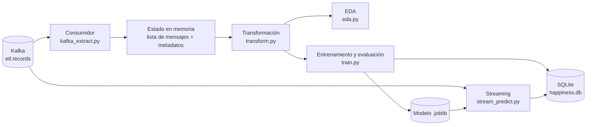

# Taller 3 — Pipeline ETL con Apache Kafka + Aprendizaje Automático

Sistema que **consume desde Kafka** los registros del [World Happiness Report](https://www.worldhappiness.report/data-sharing/) (5 archivos CSV, uno por año), los **unifica y limpia**, hace **EDA**, entrena un **modelo de regresión** para predecir el *happiness score* y **carga resultados a una base de datos** (SQLite).

**Curso:** ETL (G01) · Ingeniería de Datos e Inteligencia Artificial · **Autor:** Yurani Duque

## Arquitectura



## Estructura del repositorio

```
├── run_pipeline.py          # orquesta extract → transform → eda → train → load
├── src/
│   ├── config.py            # rutas y conexión a Kafka (variables de entorno)
│   ├── kafka_extract.py     # consumidor, acumulación en el estado, guardado crudo (.jsonl)
│   ├── state.py             # estado de la aplicación (eventos únicos, duplicados, alertas)
│   ├── transform.py         # armonización de los 5 años, limpieza, dataset final
│   ├── eda.py               # reporte de calidad + gráficos
│   ├── train.py             # modelos, validación cruzada, métricas, gráficos
│   ├── model_io.py          # serialización del modelo + metadatos (.json)
│   ├── db.py                # carga a SQLite
│   ├── viz_data.py          # lectura y KPIs para el dashboard
│   └── stream_predict.py    # consumer de aplicación: validar → inferir → guardar → commit
├── dashboard/app.py         # dashboard Streamlit sobre happiness.db
├── tests/                   # pruebas unitarias + generador de datos sintéticos
├── notebooks/               # versión en notebook (Colab) del mismo flujo
├── reports/                 # eda_summary.md, model_metrics.csv, figures/ (se generan al ejecutar)
├── requirements.txt
└── .env.example
```

## Puesta en marcha

```bash
git clone <URL_DE_TU_REPO> && cd taller3-etl-kafka-ml
python -m venv .venv && source .venv/bin/activate      # Windows: .venv\Scripts\activate
pip install -r requirements.txt

cp .env.example .env        # y completa KAFKA_PASSWORD (la da el instructor) y KAFKA_GROUP_ID (único, p. ej. student-yuraniduque)
```

### Ejecutar

```bash
python run_pipeline.py                  # pipeline completo (conecta a Kafka)
python run_pipeline.py --from-raw       # reutiliza data/raw/records.jsonl sin reconectar
python run_pipeline.py --steps train load --from-raw   # solo algunas etapas

python -m src.stream_predict            # consumer de aplicación: valida, predice y guarda en stream_predictions
streamlit run dashboard/app.py          # dashboard reactivo sobre happiness.db
python -m pytest -q                     # pruebas
```

Conexión Kafka usada: `bootstrap.servers=kafka-classroom-2026.westus.cloudapp.azure.com:9092`, `SASL_SSL`, `SCRAM-SHA-512`, usuario `classroom-students`, `ssl.ca.location=certifi.where()`, tema `etl.records`. La contraseña **nunca** se sube al repositorio (`.env` está en `.gitignore`).

## Alineación con lo visto en clase

| Tema de clase | Dónde está en este repo |
|---|---|
| S10 · Kafka con `confluent-kafka`, consumidor con `group.id`, `poll()` con intentos vacíos | `src/kafka_extract.py` |
| S11 · Flujo de ML, `Pipeline` + imputación + escalado sin fuga de datos, MAE/RMSE/R² | `src/train.py` |
| S11 · Hiperparámetros y fine-tuning; serialización de artefactos | `GridSearchCV` en `train.py`; `src/model_io.py` |
| S12 · «El estado es la memoria de la aplicación», estado ≠ evento | `src/state.py` |
| S12 · «El consumer puede convertirse en un punto de inferencia» | `src/stream_predict.py` |
| S12 / Visualización reactiva · el dashboard lee el estado/BD, no consume Kafka | `dashboard/app.py` (Streamlit) |
| Producer outbox · entrega *al menos una vez*, deduplicar por `event_id` | `apply_event` en `state.py`; `append_stream_predictions` en `db.py` |

## Decisiones técnicas

| Etapa | Decisión |
|---|---|
| Consumo | `confluent-kafka`, `auto.offset.reset=earliest`, sin auto-commit; termina tras 10 polls vacíos; deduplicación por `(partición, offset)`; se conservan metadatos (`_partition`, `_offset`, `_timestamp`, `_key`, `_headers`). |
| Estado en memoria | `PipelineState` (`src/state.py`): eventos únicos, último evento, conteo por partición, duplicados y alertas; deduplica por `(partición, offset)` y por `event_id` / `metadata.record_id` si el payload lo trae. Luego se aplana a `DataFrame` (`json_normalize`) y se guarda copia cruda en `data/raw/records.jsonl`. |
| Estructura del mensaje | Cada mensaje trae `payload = {"metadata": {source_file, year, record_id}, "data": {...columnas del CSV...}}`. Se separan datos y metadatos (`unwrap_payload` en `transform.py`); `source_file` y `record_id` se conservan como `_source_file` y `_record_id`. |
| Año | Se toma de `payload.metadata.year`; si no existe, de la *key* o los *headers* del mensaje. |
| Fusión | Reglas regex (`RULES` en `transform.py`) mapean los nombres de cada año a un esquema común; los años se apilan en **formato largo** (una fila = país-año). |
| Calidad | Coerción numérica (formatos inconsistentes → NaN), limpieza de nombres de país, deduplicación `(país, año)`, atípicos marcados con IQR (no se eliminan: son países reales). |
| Características | `gdp_per_capita`, `social_support`, `life_expectancy`, `freedom`, `corruption`, `generosity`. Se excluyen `happiness_rank` y `dystopia_residual` por **fuga de información** (derivan del score). |
| Preprocesamiento | `Pipeline` (imputación por mediana + escalado) ajustado **solo con train**. |
| Modelos | Regresión lineal (línea base interpretable), Ridge, Random Forest, Gradient Boosting; `GridSearchCV` 5-fold de hiperparámetros **solo sobre train**. El mejor modelo se elige por validación cruzada, no por test; el test se usa una sola vez para reportar. |
| Artefactos | `models/happiness_model.joblib` + `happiness_model_metadata.json` (features, métricas, versiones). El consumer carga el modelo una vez; no se reentrena por evento. |
| Streaming | Consumer de aplicación: valida cada registro (rangos y predictoras mínimas), predice los válidos, guarda en SQLite y **confirma el offset después de guardar** (al-menos-una-vez); la inserción es idempotente por `(partición, offset)`. |
| Métricas | MAE, MSE, RMSE, R² y R² ajustado en test; chequeo adicional con split por país. |

## Limitaciones

- Un mismo país aparece en varios años → un split aleatorio puede filtrar información entre train y test. Se contrasta con un split por país (`reports/group_split_check.json`), pero ese chequeo se hizo solo con regresión lineal; falta repetirlo con el Random Forest.
- Los nombres de columnas cambian entre años y `Family` (2015–2017) y `Social support` (2018+) son conceptos cercanos pero no idénticos. Las medias de algunas variables cambian de nivel entre años (p. ej. `social_support`: 0.99 en 2015, 0.79 en 2016, 1.19 en 2017), lo que sugiere diferencias de escala o de metodología del reporte.
- Varias variables tienen mínimos de 0.000. Se conservaron como valores reales; no se verificó si alguno corresponde a un dato ausente.
- `corruption` tiene 1 valor faltante (imputado con la mediana de train) y concentra la mayoría de los atípicos.
- Posibles mejoras: incluir `region` y `year`, ampliar la búsqueda de hiperparámetros, validación temporal, transformaciones no lineales.

## Resultados

Datos recibidos de Kafka: **782 registros** sin duplicados (2015: 158, 2016: 157, 2017: 155, 2018: 156, 2019: 156), repartidos en 3 particiones. Split 80/20: 625 registros de entrenamiento y 157 de prueba.

### Resumen del EDA

- **Columnas distintas entre años:** solo `Generosity` se escribe igual en los 5 archivos. 2017 usa puntos (`Happiness.Score`) y 2018–2019 usan `Score`, `Social support`, `Freedom to make life choices`. Columnas exclusivas: `Standard Error` (2015) e intervalos de confianza (2016), que no se usan como predictoras. Se armonizaron con reglas de equivalencia.
- **Calidad:** 1 valor faltante (`corruption`). Atípicos por IQR (solo marcados, no eliminados): `corruption` 67 (8.6 %), `generosity` 17 (2.2 %), `social_support` 10 (1.3 %); el puntaje no tiene atípicos.
- **Estabilidad del objetivo:** la media del puntaje es estable entre años (5.35 a 5.41), aunque algunas predictoras cambian de nivel.
- **Correlación con el puntaje:** PIB per cápita 0.79, esperanza de vida 0.74, apoyo social 0.65, libertad 0.55, corrupción 0.40, generosidad 0.14.
- **Decisión de integración:** los 5 años se apilan en formato largo (una fila = país-año), con las 6 variables como predictoras.

### Métricas en el conjunto de prueba (157 registros)

| Modelo | MAE | MSE | RMSE | R² | R² ajustado | RMSE CV |
|---|---|---|---|---|---|---|
| **RandomForest (elegido)** | 0.4148 | 0.2878 | 0.5365 | 0.7762 | 0.7673 | 0.4878 |
| GradientBoosting | 0.4266 | 0.2985 | 0.5463 | 0.7679 | 0.7587 | 0.5071 |
| Ridge | 0.4428 | 0.3364 | 0.5800 | 0.7384 | 0.7280 | 0.5460 |
| LinearRegression | 0.4428 | 0.3356 | 0.5793 | 0.7391 | 0.7287 | 0.5461 |

Hiperparámetros elegidos con `GridSearchCV` (5-fold, solo sobre train):

| Modelo | Mejores parámetros |
|---|---|
| RandomForest | `max_depth=None`, `min_samples_leaf=1` |
| GradientBoosting | `learning_rate=0.05`, `max_depth=3` |
| Ridge | `alpha=10` |
| LinearRegression | sin hiperparámetros |

Chequeo con split por país (regresión lineal): MAE 0.4502, MSE 0.3485, RMSE 0.5903, R² 0.7737, R² ajustado 0.7645.

### Interpretación

El Random Forest fue el mejor modelo, tanto por validación cruzada (criterio de selección) como en el conjunto de prueba. Su MAE de 0.41 indica que, en promedio, la predicción se desvía unos 0.4 puntos de la puntuación real (escala 0–10), y su R² de 0.78 indica que explica cerca del 78 % de la variabilidad. La mejora frente a la regresión lineal (R² 0.74) es moderada, lo que sugiere que la relación entre las variables y la felicidad es en gran parte lineal. El R² ajustado casi no baja respecto al R², así que las 6 predictoras aportan información. El RMSE de validación cruzada (0.49) y el de prueba (0.54) están en un rango similar, por lo que no se observa sobreajuste fuerte; la diferencia se explica en parte por el tamaño del conjunto de prueba. La regresión lineal con split por país (R² 0.77) rinde a un nivel parecido al split aleatorio (R² 0.74), sin señal de deterioro, aunque son conjuntos de prueba distintos y el chequeo falta con el Random Forest.

### Archivos generados

- `reports/eda_summary.md` — columnas comunes/únicas por año, faltantes, atípicos, correlaciones.
- `reports/model_metrics.csv` — métricas e hiperparámetros por modelo.
- `reports/figures/` — gráficos del EDA y del desempeño del modelo.

## Solución de problemas

- `Falta KAFKA_PASSWORD`: crea `.env` a partir de `.env.example`.
- `Faltan columnas tras la armonización`: revisa los nombres originales (`reports/eda_summary.md`) y agrega una regla en `RULES`.
- Años en `NaN`: el mensaje no trae año reconocible; ajusta `YEAR_CANDIDATES` en `src/transform.py`.
- Sin conexión a Kafka: `tests/synthetic.py` genera mensajes sintéticos para probar el código (solo desarrollo, **no** para el entregable).
- No llegan mensajes: el `group.id` ya tenía offsets confirmados, o el tema/credenciales son incorrectos. Usa un `KAFKA_GROUP_ID` nuevo.