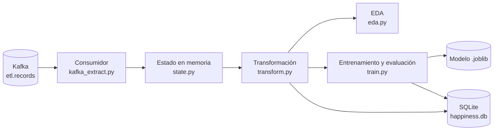

# Taller 3 — Pipeline ETL con Apache Kafka + Aprendizaje Automático

**Curso:** ETL (G01) · Ingeniería de Datos e Inteligencia Artificial · **Autor:** Yurani Duque

Sistema que **consume desde Apache Kafka** los registros del [World Happiness Report](https://www.worldhappiness.report/data-sharing/) (5 archivos CSV, años 2015–2019), los acumula en memoria, los **unifica y limpia**, realiza el **análisis exploratorio (EDA)**, entrena un **modelo de regresión** para predecir la puntuación de felicidad (`happiness_score`), evalúa su desempeño y **carga los resultados en una base de datos SQLite**.

**Tecnologías:** Python · Apache Kafka (`confluent-kafka`) · SQLite · Matplotlib / Seaborn · Scikit-learn.

---

## 1. Arquitectura



## 2. Estructura del repositorio

```
├── run_pipeline.py          # orquesta extract → transform → eda → train → load
├── src/
│   ├── config.py            # rutas y conexión a Kafka (variables de entorno)
│   ├── kafka_extract.py     # consumidor Kafka y guardado de los mensajes crudos (.jsonl)
│   ├── state.py             # estado en memoria (eventos únicos, duplicados)
│   ├── transform.py         # armonización de los 5 años, limpieza, dataset final
│   ├── eda.py               # reporte de calidad + gráficos del EDA
│   ├── train.py             # modelos, validación cruzada, métricas, gráficos
│   ├── model_io.py          # serialización del modelo + metadatos
│   └── db.py                # carga a SQLite
├── tests/                   # pruebas unitarias
├── reports/                 # eda_summary.md, model_metrics.csv, figures/
├── requirements.txt
└── .env.example             # plantilla de configuración (sin contraseña)
```

El repositorio incluye además, como extras no exigidos por el taller, un consumidor de inferencia en streaming (`src/stream_predict.py`) y un dashboard (`dashboard/app.py`).

---

## 3. Cómo reproducir la solución

### 3.1 Instalación

```bash
git clone https://github.com/yurani-duque/WORKSHOP_3.git
cd WORKSHOP_3
python -m venv .venv
.venv\Scripts\activate            # Mac/Linux: source .venv/bin/activate
pip install -r requirements.txt
```

### 3.2 Configuración de la conexión a Kafka

Copia la plantilla y completa la contraseña (la entrega el instructor):

```bash
copy .env.example .env            # Mac/Linux: cp .env.example .env
```

| Parámetro | Valor |
|---|---|
| `bootstrap.servers` | `kafka-classroom-2026.westus.cloudapp.azure.com:9092` |
| `security.protocol` | `SASL_SSL` |
| `sasl.mechanism` | `SCRAM-SHA-512` |
| `sasl.username` | `classroom-students` |
| `sasl.password` | variable `KAFKA_PASSWORD` del archivo `.env` |
| `ssl.ca.location` | `certifi.where()` |
| Tema | `etl.records` |
| `group.id` | variable `KAFKA_GROUP_ID` (p. ej. `student-yuraniduque`) |

La contraseña **nunca** se sube al repositorio: `.env` está en `.gitignore`.

### 3.3 Ejecución

```bash
python run_pipeline.py                  # pipeline completo (conecta a Kafka)
python run_pipeline.py --from-raw       # reutiliza data/raw/records.jsonl sin reconectar
python run_pipeline.py --steps train load --from-raw   # solo algunas etapas
python -m pytest -q                     # pruebas unitarias
```

El pipeline genera: `data/raw/records.jsonl` (mensajes crudos), `data/processed/*.csv` (datos limpios y de modelado), `models/happiness_model.joblib`, `happiness.db` y los archivos de `reports/`.

---

## 4. Flujo de trabajo y decisiones

### 4.1 Extracción de datos (Kafka)

1. **Consumidor** (`kafka_extract.py`): se conecta al broker con `confluent-kafka`, se suscribe a `etl.records` y consume con `poll()` hasta recibir 10 intentos vacíos seguidos. Usa `auto.offset.reset=earliest` y sin auto-commit.
2. **Estructura del mensaje.** Cada mensaje trae metadatos de Kafka (tema, partición, offset, timestamp, key, headers) y un `payload` con esta forma:
   ```json
   {"metadata": {"source_file": "2015.csv", "year": 2015, "record_id": "2015-4"},
    "data": {"Country": "Norway", "Happiness Score": 7.522, "Economy (GDP per Capita)": 1.459, "...": "..."}}
   ```
   Los metadatos de Kafka se conservan con prefijo `_` (`_partition`, `_offset`, `_timestamp`, `_key`) y los del mensaje como `_source_file` y `_record_id`.
3. **Acumulación en memoria** (`state.py`): los mensajes se guardan en un objeto `PipelineState` que descarta duplicados por `(partición, offset)` y por `record_id`, y registra el conteo por partición. Después se guarda una copia cruda en `data/raw/records.jsonl`.

**Verificación:** se recibieron 782 mensajes únicos (0 duplicados) distribuidos en 3 particiones (228, 269 y 285).

### 4.2 Preparación de datos

- **Aplanado y año:** se separa `data` de `metadata`; el año se toma de `metadata.year` (si faltara, de la *key* o los *headers*).
- **Columnas comunes y únicas:** los nombres de columna cambian entre años (ver 5.1). Se armonizan con reglas de equivalencia por expresiones regulares (`RULES` en `transform.py`) hacia un esquema común: `country`, `happiness_score`, `gdp_per_capita`, `social_support`, `life_expectancy`, `freedom`, `corruption`, `generosity`.
- **Lógica de fusión:** los 5 años se apilan en **formato largo** (una fila = país-año), lo que conserva toda la información y permite usar el año como variable.
- **Calidad de datos:** conversión numérica (formatos inconsistentes → `NaN`), limpieza de nombres de país (p. ej. `Taiwan Province of China` → `Taiwan`), eliminación de duplicados `(país, año)`, y atípicos marcados con la regla del IQR (no se eliminan: son países reales).
- **Selección de características:** `gdp_per_capita`, `social_support`, `life_expectancy`, `freedom`, `corruption`, `generosity`. Se **excluyen** `happiness_rank` y `dystopia_residual` por **fuga de información** (se calculan a partir del puntaje).
- **Variable objetivo:** `happiness_score`.

### 4.3 Entrenamiento del modelo

- **Split** 80 % entrenamiento (625 registros) / 20 % prueba (157 registros), con semilla fija.
- **Preprocesamiento sin fuga de datos:** imputación por mediana + estandarización dentro de un `Pipeline` de scikit-learn que se ajusta **solo con el conjunto de entrenamiento**.
- **Modelos comparados:** Regresión Lineal (línea base interpretable), Ridge, Random Forest y Gradient Boosting, con `GridSearchCV` de 5 particiones **solo sobre entrenamiento**.
- **Selección:** el mejor modelo se elige por validación cruzada, no por el conjunto de prueba; el conjunto de prueba se usa una sola vez para reportar.

### 4.4 Evaluación

MAE, MSE, RMSE, R² y R² ajustado sobre el conjunto de prueba, comparación de predicciones contra valores reales, gráficos de desempeño, importancia de variables y un chequeo adicional separando los datos **por país**.

### 4.5 Carga a base de datos

`db.py` guarda en `happiness.db` las tablas `happiness_clean` (dataset de modelado) y `happiness_predictions` (valores reales y predichos del conjunto de prueba).

---

## 5. Resultados

### 5.1 Resumen del EDA

- **Datos:** 782 registros (2015: 158, 2016: 157, 2017: 155, 2018: 156, 2019: 156).
- **Columnas distintas entre años:** solo `Generosity` se escribe igual en los 5 archivos. 2017 usa puntos (`Happiness.Score`) y 2018–2019 usan `Score`, `Social support`, `Freedom to make life choices`. Columnas exclusivas: `Standard Error` (2015) e intervalos de confianza (2016), que no se usan como predictoras.
- **Calidad:** 1 valor faltante (`corruption`). Atípicos por IQR (solo marcados): `corruption` 67 (8.6 %), `generosity` 17 (2.2 %), `social_support` 10 (1.3 %); el puntaje no tiene atípicos.
- **Estabilidad del objetivo:** la media del puntaje es estable entre años (5.35 a 5.41), aunque algunas predictoras cambian de nivel (p. ej. `social_support`: 0.99 en 2015, 0.79 en 2016, 1.19 en 2017).
- **Correlación con el puntaje:** PIB per cápita 0.79, esperanza de vida 0.74, apoyo social 0.65, libertad 0.55, corrupción 0.40, generosidad 0.14.

### 5.2 Métricas en el conjunto de prueba (157 registros)

| Modelo | MAE | MSE | RMSE | R² | R² ajustado | RMSE CV |
|---|---|---|---|---|---|---|
| **RandomForest (elegido)** | 0.4148 | 0.2878 | 0.5365 | 0.7762 | 0.7673 | 0.4878 |
| GradientBoosting | 0.4266 | 0.2985 | 0.5463 | 0.7679 | 0.7587 | 0.5071 |
| Ridge | 0.4428 | 0.3364 | 0.5800 | 0.7384 | 0.7280 | 0.5460 |
| LinearRegression | 0.4428 | 0.3356 | 0.5793 | 0.7391 | 0.7287 | 0.5461 |

Hiperparámetros elegidos con `GridSearchCV`:

| Modelo | Mejores parámetros |
|---|---|
| RandomForest | `max_depth=None`, `min_samples_leaf=1` |
| GradientBoosting | `learning_rate=0.05`, `max_depth=3` |
| Ridge | `alpha=10` |
| LinearRegression | sin hiperparámetros |

Chequeo con split por país (regresión lineal): MAE 0.4502, MSE 0.3485, RMSE 0.5903, R² 0.7737, R² ajustado 0.7645.

### 5.3 Interpretación

El Random Forest fue el mejor modelo, tanto por validación cruzada (criterio de selección) como en el conjunto de prueba. Su **MAE de 0.41** indica que, en promedio, la predicción se desvía unos 0.4 puntos de la puntuación real (escala 0–10), y su **R² de 0.78** indica que explica cerca del 78 % de la variabilidad. La mejora frente a la regresión lineal (R² 0.74) es moderada, lo que sugiere que la relación entre las variables y la felicidad es en gran parte lineal. El R² ajustado casi no baja respecto al R², así que las 6 predictoras aportan información. El RMSE de validación cruzada (0.49) y el de prueba (0.54) están en un rango similar, por lo que no se observa sobreajuste fuerte; la diferencia se explica en parte por el tamaño del conjunto de prueba. La regresión lineal con split por país (R² 0.77) rinde a un nivel parecido al split aleatorio (R² 0.74), sin señal de deterioro, aunque son conjuntos de prueba distintos y el chequeo falta con el Random Forest.

### 5.4 Visualizaciones

Se generan en `reports/figures/`:

| Archivo | Contenido |
|---|---|
| `01_target.png` | Distribución del puntaje de felicidad |
| `02_correlation.png` | Matriz de correlación |
| `03_scatter_features.png` | Relación de cada variable con el puntaje |
| `04_boxplots.png` | Boxplots y atípicos |
| `05_missing.png` | Valores faltantes |
| `06_model_performance.png` | Predicho vs. real y residuos |
| `07_feature_importance.png` | Importancia de las variables |
| `08_model_comparison.png` | Comparación de los modelos |

Los demás reportes están en `reports/eda_summary.md` y `reports/model_metrics.csv`.

---

## 6. Limitaciones y mejoras

- Un mismo país aparece en varios años, por lo que un split aleatorio puede filtrar información entre entrenamiento y prueba. El chequeo por país (`reports/group_split_check.json`) se hizo solo con regresión lineal; falta repetirlo con el Random Forest.
- `Family` (2015–2017) y `Social support` (2018+) son conceptos cercanos pero no idénticos, y los niveles de algunas variables cambian entre años, lo que sugiere diferencias de escala o de metodología del reporte.
- Varias variables tienen mínimos de 0.000. Se conservaron como valores reales; no se verificó si alguno corresponde a un dato ausente.
- `corruption` tiene 1 valor faltante (imputado con la mediana del entrenamiento) y concentra la mayoría de los atípicos.
- **Mejoras posibles:** incluir `region` y `year` como variables, ampliar la búsqueda de hiperparámetros, validación temporal (entrenar con años previos y probar en el último) y transformaciones no lineales.
